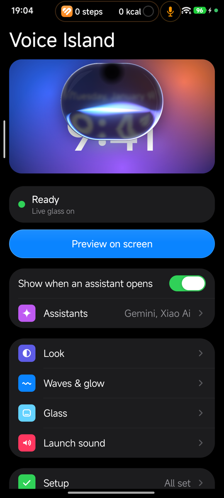
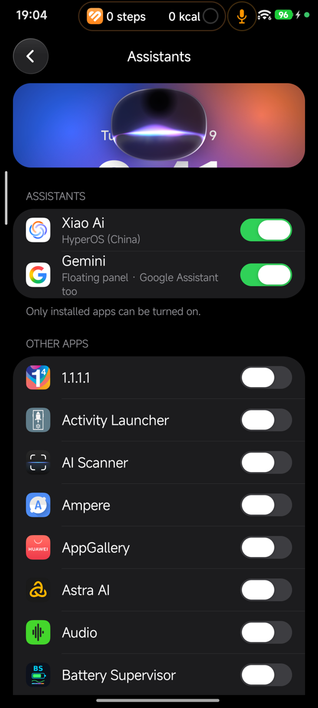
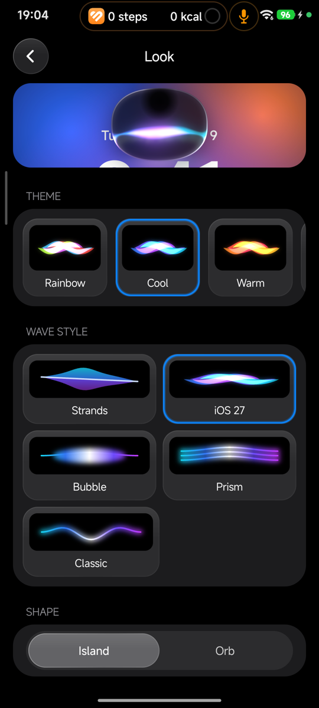

# Voice Island

An iOS 27-style voice island for Android. When your assistant opens (Xiao Ai, the Gemini overlay, or
any app you pick), a liquid-glass bubble grows out of the camera cutout. Light strands inside it react
to your voice and to the assistant's.

No root needed. Built and tested on a Redmi Note 12 Turbo with HyperOS 3.

<p>
  
  
  
</p>

## Features

- **Strands light:** a port of React Bits Strands, with 16 colour themes and adjustable shape, light and speed.
- **Liquid glass:** the bubble bends and blurs the wallpaper behind it in real time (needs Shizuku), and stretches like jelly when you pull it.
- **Thinking animation:** while the assistant works out an answer, the strands dim and two comets circle the rim.
- **Assistants:** Xiao Ai, Gemini (its floating panel, not Google Search; tested on MIUI 14 when held on the power button), or any installed app.
- **Shapes and sound:** iPhone island or iPad/Mac-style orb, and an optional launch sound.
- **Home-screen widgets:**
  - **Theme (2×2):** the island in your colours, with arrows that go through the themes.
  - **Orb (2×2):** a glass orb on your wallpaper that opens your assistant.
  - **Switch (2×1):** turns the island on or off.
  - **Animations:** changing the theme pops the new one in. A slow idle animation is available too, off by default. Both have switches under Advanced.
- **Settings in the iOS 27 style:** liquid toggles, a glass segmented control, and predictive back.

## Requirements

- Android 13 or newer.
- **Accessibility service:** required. It is used only to notice which app owns the window on screen; no screen text is read or stored.
- **[Shizuku](https://shizuku.rikka.app/):** optional. It is needed for the live glass and to hide HyperOS's own island while Xiao Ai is open. Without it, the bubble uses its own glass body.
- **Microphone:** optional. It makes the strands react to your voice. Audio never leaves the phone.

## Install

1. Download the APK from [Releases](../../releases) and install it.
2. Open Voice Island, go to **Setup** and turn on the accessibility service. If Android greys the service out, open App info → ⋮ → *Allow restricted settings* first.
3. Optional: install Shizuku, start it, and tap **Set up** next to Shizuku.
4. On HyperOS / MIUI: set Voice Island to **Autostart** and **Battery saver → No restrictions**, so the system doesn't stop it.

## Known limits

- **Gemini:** Gemini's own panel stays visible. The bubble appears above it at the top of the screen.
- **Other assistants:** Bixby and similar assistants work through **Assistants → Other apps**. Then the bubble shows whenever that app has a window on screen.
- **Hiding the system island:** this works only with Xiao Ai on HyperOS.

## Build

```sh
./gradlew :app:assembleRelease
```

The build needs JDK 17+ and the Android SDK (compileSdk 36). Builds are signed with the debug key
unless `app/siri-island.keystore` exists.

## Credits

See [THIRD_PARTY_NOTICES.md](THIRD_PARTY_NOTICES.md): React Bits Strands (MIT + Commons Clause),
Kyant0's AndroidLiquidGlass, the Shizuku API and AndroidHiddenApiBypass (Apache 2.0).

Voice Island is not affiliated with Apple, Xiaomi or Google. Siri and iOS are trademarks of Apple
Inc.; Xiao Ai is a trademark of Xiaomi; Gemini is a trademark of Google LLC.
